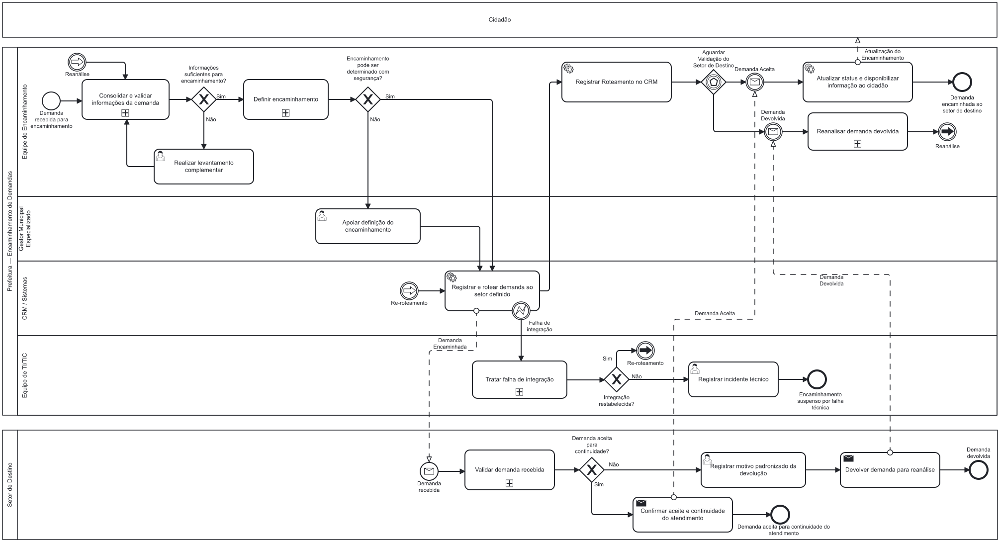
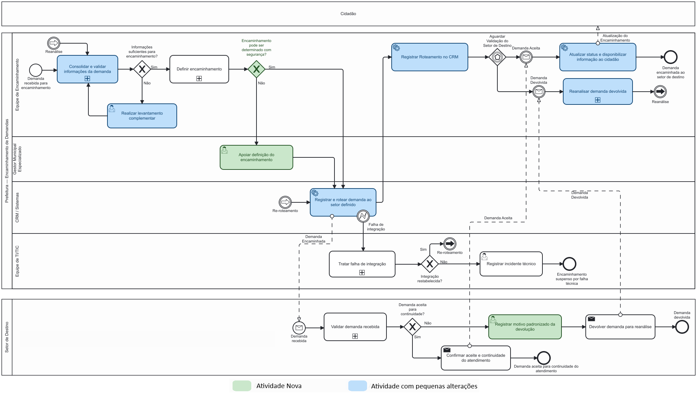

# Encaminhamento de Demandas — BPMN TO-BE

## Sobre o projeto

Este repositório reúne os artefatos desenvolvidos para a modelagem do processo de negócio TO-BE de Encaminhamento de Demandas, no contexto de um projeto acadêmico de transformação digital.

O objetivo é apresentar a modelagem do processo futuro, o detalhamento dos subprocessos, as alterações realizadas em relação ao processo AS-IS e os indicadores de desempenho associados ao processo.

As melhorias propostas estão orientadas pelos seguintes drivers de negócio: Agilidade, Eficiência, Efetividade e Transparência.

## 1. Processo de Negócio TO-BE

O diagrama apresenta a modelagem consolidada do processo futuro de Encaminhamento de Demandas, utilizando a notação BPMN (Business Process Model and Notation).

[Visualizar diagrama em resolução completa](./01-processo-principal/encaminhamento-tobe.png)

## 2. Processo TO-BE — Destaque das alterações

Esta versão do diagrama apresenta a identificação visual das alterações realizadas em relação ao processo AS-IS, permitindo distinguir os elementos novos, modificados e preservados.

[Visualizar diagrama com destaque das alterações](./01-processo-principal/encaminhamento-tobe-alteracoes.png)

### Legenda

| Cor | Classificação |
|---|---|
| 🟩 Verde | Elementos novos |
| 🟦 Azul | Elementos modificados |
| ⬜ Branco | Elementos preservados |

Os elementos excluídos são identificados na documentação comparativa, uma vez que não fazem mais parte do fluxo TO-BE.

## 3. Subprocessos

Os diagramas a seguir apresentam o detalhamento das atividades representadas como subprocessos no processo principal.

| Nº | Subprocesso | Diagrama |
|---|---|---|
| 01 | Consolidar e validar informações da demanda | [Visualizar](./02-subprocessos/01-consolidar-e-validar-informacoes.png) |
| 02 | Definir encaminhamento | [Visualizar](./02-subprocessos/02-definir-encaminhamento.png) |
| 03 | Reanalisar demanda devolvida | [Visualizar](./02-subprocessos/03-reanalisar-demanda-devolvida.png) |
| 04 | Tratar falha de integração | [Visualizar](./02-subprocessos/04-tratar-falha-de-integracao.png) |
| 05 | Validar demanda recebida | [Visualizar](./02-subprocessos/05-validar-demanda-recebida.png) |

## 4. Análise comparativa AS-IS e TO-BE

O documento de análise comparativa apresenta individualmente as alterações realizadas na transição do processo AS-IS para o TO-BE, incluindo a descrição das mudanças e os respectivos elementos BPMN.

As alterações estão organizadas em três categorias:

- Elementos modificados.
- Elementos novos.
- Elementos excluídos.

[Acessar documento de análise comparativa (PDF)](./03-documentacao/analise-comparativa-as-is-to-be.pdf)

### Principais alterações

- Consolidação e validação das informações da demanda.
- Redistribuição da responsabilidade pelo levantamento complementar.
- Inclusão de apoio especializado à definição do encaminhamento.
- Automatização do registro e roteamento das demandas.
- Automatização do registro de roteamento no CRM.
- Automatização da atualização de status e disponibilização de informações ao cidadão.
- Padronização dos motivos de devolução.
- Reestruturação da reanálise das demandas devolvidas.
- Exclusão da raia Equipe de Análise.

## 5. Indicadores de desempenho

A planilha de indicadores de desempenho apresenta os indicadores associados ao processo de Encaminhamento de Demandas, destinados ao acompanhamento e à avaliação de seu desempenho.

[Acessar planilha de indicadores de desempenho (Excel)](./04-indicadores/indicadores-de-desempenho.xlsx)

## 6. Resultados esperados

- Maior agilidade no encaminhamento das demandas.
- Redução de encaminhamentos inadequados.
- Redução de devoluções e retrabalho.
- Maior padronização das informações.
- Redução de atividades manuais.
- Maior rastreabilidade das demandas.
- Maior transparência para o cidadão.

## 7. Organização do repositório

| Diretório | Conteúdo |
|---|---|
| `01-processo-principal` | Diagramas BPMN TO-BE, com e sem destaque das alterações. |
| `02-subprocessos` | Diagramas de detalhamento dos subprocessos. |
| `03-documentacao` | Documento de análise comparativa entre AS-IS e TO-BE. |
| `04-indicadores` | Planilha de indicadores de desempenho do processo. |

---

Projeto acadêmico de modelagem de processos de negócio e transformação digital.
